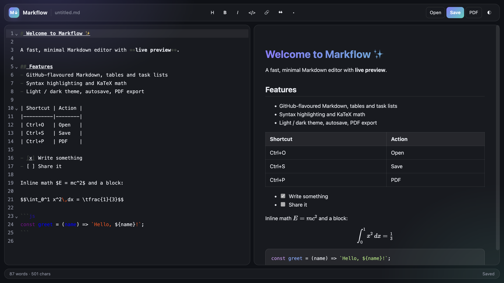

<h1 align="center">Markflow</h1>

<p align="center">
  A fast, minimal Markdown editor with live preview, math and syntax highlighting.<br>
  Runs in the browser or as a desktop app.
</p>

<p align="center">
  <a href="https://github.com/SimaKogan/markflow/actions"></a>
  
  
  
</p>

<p align="center">
  
</p>

## Features

- Live preview with synchronised scrolling
- GitHub-flavoured Markdown (tables, task lists)
- Syntax highlighting in code blocks (highlight.js) and math (KaTeX): `$E = mc^2$` and `$$ ... $$`
- Light and dark theme, draft autosaved in the browser storage
- Open and save files; export to PDF (`Ctrl/Cmd+P` → *Save as PDF*, always printed in the light palette)
- Asks before closing a window with unsaved changes
- Secure Electron setup: `contextIsolation`, sandbox, sanitised HTML (DOMPurify), files written only to paths you picked in a dialog

## Getting started

```bash
npm install
npm run dev      # run in the browser (Vite dev server)
npm start        # build and run the desktop app
npm run dist     # package installers into ./release
npm test         # unit tests for the math handling
```

Requires [Node.js](https://nodejs.org/) 18+.

## Shortcuts

Use `Cmd` instead of `Ctrl` on macOS.

| Key | Action |
|-----|--------|
| `Ctrl+O` | Open file |
| `Ctrl+S` | Save file |
| `Ctrl+P` | Export PDF |
| `Ctrl+B` / `Ctrl+I` / `Ctrl+K` | Bold / italic / link |

## Project layout

```text
src/            editor, preview, styles (math handling in math.mjs)
electron/       main process and preload bridge
test/           node:test unit tests
docs/           screenshot
```

## Author

Serafima Kogan — [@SimaKogan](https://github.com/SimaKogan) · serafima.kogan@gmail.com

## License

[MIT](LICENSE)
